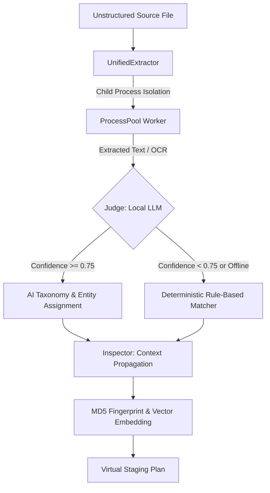

# FileFlow
### Forensic Local AI File Organisation Engine for Legal & Professional Archives

---

> ### 🔒 Data Privacy & Verification Notice
> **Proprietary Codebase:** The complete source codebase for this project is hosted in a private repository to maintain local system sovereignty, protect LLM orchestration logic, and safeguard personal data handling. 
> 
> **Live Verification:** This repository serves as the public system architecture map and technical documentation. I am highly comfortable performing a live, end-to-end system demonstration and code walk-through during an interview to verify all architectural implementations and logic flows.

---

## 🎥 System Walkthrough & Interactive Demo

Watch FileFlow conduct an autonomous, content-aware forensic organization pass across nested unstructured legal directories, demonstrating safe quick-look previews, relational file clustering, and automatic rule enforcement:

https://github.com/user-attachments/assets/fileflow_walkthrough.mp4

> *Video file also bundled locally in [`media/fileflow_walkthrough.mp4`](media/fileflow_walkthrough.mp4).*

---

## 🏛️ Executive Summary

**FileFlow** is an offline, forensic file organization engine designed specifically for legal practitioners, corporate compliance officers, and document-heavy professional environments.

Instead of relying on fragile, user-assigned file names (e.g., `CV_FINAL_v3.pdf` or `Agreement_Signed_New.docx`), FileFlow recursively scans chaotic unstructured directories, extracts and reads the *actual substantive contents* of every document using an offline local AI cognition stack, and organizes them into an intuitive, deterministic archive. It handles corrupted files, unreadable scans, and duplicates seamlessly — without ever risking original files or sending a single byte of confidential data to the cloud.

---

## 🛡️ The Four Architectural Guarantees

FileFlow is engineered around four strict safety constraints enforced at the core engine level:

1. **Non-Destructive Execution:** Original files are never moved or altered until a bit-perfect copy is MD5-verified at the destination.
2. **100% Offline Air-Gapped Local Inference:** All AI inference runs locally via [Ollama](https://ollama.ai) on the host machine. Zero network calls to external APIs. No file contents or client metadata ever leave the local workstation.
3. **Full Atomic Rollback:** A persistent `TransactionLedger` logs every atomic file operation. A single command can completely reverse an entire organization session back to its original state.
4. **Forensic Audit Trail (POPIA s19):** A verifiable `Forensic_Manifest.json` is generated for every pass, cryptographically mapping every file's source path, target path, and MD5 hash for compliance records.

---

## 🧠 The Phase 2 Cognition Stack

Every discovered file passes through a multi-tier analysis pipeline before any movement is planned or executed:

### Classification Decision Tree
1. **Bridge Health Check:** If the local Ollama server is active, dispatch to the Sovereign Archivist prompt. If offline, gracefully degrade to rule-based classification silently without crashing.
2. **Confidence Thresholding:**
   - **`Confidence >= 0.75`:** Assign LLM-derived document category, governing client entity, and standardized naming.
   - **`Confidence < 0.75`:** Fall back to keyword and regular expression matchers mapped to regulatory templates.
3. **Inspector Context Propagation:** Solves grounding errors by inspecting sibling directory contexts and matter metadata before categorizing isolated attachments.

---

## ⚡ Advanced Capabilities

### 1. In-App Quick-Look Safe Preview
Inspect document text and extract previews directly from the UI without launching heavy external viewers or triggering dangerous active-content payloads in PDFs or macro-enabled documents.

### 2. Autonomous Watch Folder System
Monitor incoming intake folders (e.g. Scans, Downloads, Case Intake) and automatically trigger rule-based or AI-assisted filing into structured client repositories upon file arrival.

### 3. Relational Clustering & Semantic Deduplication
- **MD5 Exact Duplication:** Identifies identical byte files across nested subdirectories and consolidates them into canonical locations.
- **LanceDB Vector Search:** Embeds document text into local vector space (`vectors.lance`) to surface near-duplicate drafts, prior revisions, and related pleadings.

---

## 🛠️ Technology Stack & Benchmarks

- **Core Logic:** Python 3.10+ (utilizing walrus `:=` hash streaming, dataclasses, asynchronous task executors), pywebview / FastAPI bridge.
- **Inference Engine:** Offline Ollama local server running `ministral-3:3b` (classification) and `qwen3-embedding:4b` (semantic deduplication).
- **Vision OCR:** `qwen3-vl:4b` for scanned invoices, court stamps, and legacy unsearchable PDFs.
- **Vector Memory:** LanceDB local embedded vector database (`vectors.lance`).
- **PDF Extraction Architecture:** Isolated child processes via `multiprocessing.Pool` with hard timeouts to prevent corrupted or malicious PDFs from crashing the engine.
- **Throughput:** Scans and processes standard legal folders at **200+ files per second** (I/O bound) on consumer NVMe hardware.

---

Architected and maintained by **Sandiso Mazibuko**.
